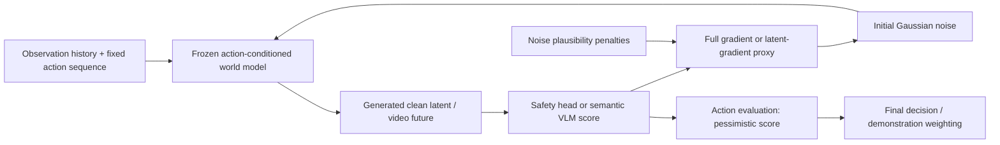

> Public archival copy. Local absolute paths are redacted; this is not represented as byte-identical to the frozen original. Source/public SHA-256 mappings are in `reproducibility/evidence_manifest.json`. This historical stage predates the measured Gate 1A; later measured status is in gate1a_measured_results.md and scientific_feasibility_verdict.md. Hypotheses and experiment designs remain proposals unless a later measurement record explicitly states execution.

# Repository audit and execution map

Audit date: 2026-10-21 (Asia/Shanghai). Paper: arXiv:2606.00267v2, 6 October 2026. Code revision: `b16fa067d3d949ef09ad48a984c62ea8ecbbfe6d`.

Evidence labels: **[P] Documented by the paper** (author-reported results, not independently reproduced); **[C] Verified in source code** (static inspection); **[E] Executed and measured** (only explicitly identified audit operations); **[H] Hypothesis only** (includes proposed experiments and analytical interpretations). Unresolved provenance or access is marked **unverified**. No model inference, simulation experiment, training, paid API call, or outreach was performed.

## Isolated checkout and actual execution

Official origin: `https://github.com/CMU-IntentLab/StressDream.git`.

New isolated checkout: `[LOCAL_PATH_REDACTED]`.

The repository was shallow-cloned at `b16fa067d3d949ef09ad48a984c62ea8ecbbfe6d` with a sparse working tree. Source, configs, notebooks and small example inputs were checked out. Checkpoint, example-HDF5 and media paths were excluded from the working tree. No existing research checkout was inspected or changed. `git status --short` was empty at the inspected revision. [E audit operations]

Operational disclosure: the first metadata command, `git ls-tree -r -l HEAD`, on a partial clone triggered Git's automatic retrieval of some blobs, including the 33,104,560-byte example HDF5 and some media, before it was interrupted. These reference bytes may remain in the new clone's Git object store on C; they were not opened as experimental data. No `.pt` or `.pth` checkpoint was downloaded or loaded. Later inventory used GitHub's tree metadata and the sparse exclusions. [E]

Only retrieval, text parsing, source inspection, Git metadata and document generation were executed. No import or execution of repository model, simulator, notebook or training code occurred. Every method behavior below is [C], rather than [E].

## Stage map

The loop through noise is implemented. The last edge is a **paper-described downstream use**, not a general released action-selection application. The shared `wm_steer/` package supplies regularizers and utilities; domain entry points implement the steering loops.

| Stage | Dubins | Vista | Ctrl-World | Evidence boundary |
|---|---|---|---|---|
| Input | State rendered by `get_frame`; fixed scalar action array; VAE initial encoding. | Image plus optional future-waypoint JSON; condition preparation. | HDF5 camera/EE/gripper history or single-image fallback; replay action conditioning. | [C] Input paths do not demonstrate comparable counterfactual outcomes. |
| WM | `DiffusionWorldModel` and five-step EDM/Euler sampler. | Vendored `vwm` model and fifty-step sampler. | Ctrl-World pipeline and SVD VAE. | [C] Frozen weights loaded by scripts; none loaded here. |
| Noise steering | `optimize_noise`, per-step full or approximate gradient. | Detached generated latent, decoder/X-CLIP gradient transferred to noise. | Detached latent default, multi-view Qwen gradient reshaped and transferred to stacked-view noise. | [C] Optimizes noise, not candidate actions. |
| Generated future | VAE latent decoding; autoregressive state advances using best latent. | 25-frame video and per-iteration MP4s. | Five-frame three-view segments, autoregressive best-latent history. | [C] Demo outputs are predictions. |
| Failure score | Learned margin head; positive means inside obstacle. | X-CLIP target probability, optional Qwen yes/no margin. | Task-configurable Qwen yes/no margin. | [C] Scores are not calibrated failure probabilities. |
| Action evaluation | One fixed sequence receives an imagined margin history. | One conditioning trajectory receives semantic scores. | One replay sequence receives per-window failure scores. | [C] Batch finite-action ranking wrapper must be added in a future experiment. |
| Final decision | No released automatic robust action selector identified. | No released planner identified. | No released π0.5 robust weighted fine-tuning/evaluation harness identified. | [P] Paper §6.2/D.5 implements weighted fine-tuning; [C] release is steering demos. |

## Immutable code evidence

All links below pin the audited revision; line intervals are scope guides for static inspection.

| Component | Source location | What was verified |
|---|---|---|
| Deterministic dynamics / geometry | [env.py L11](https://github.com/CMU-IntentLab/StressDream/blob/b16fa067d3d949ef09ad48a984c62ea8ecbbfe6d/dubins/env.py#L11), [L22](https://github.com/CMU-IntentLab/StressDream/blob/b16fa067d3d949ef09ad48a984c62ea8ecbbfe6d/dubins/env.py#L22), [L88](https://github.com/CMU-IntentLab/StressDream/blob/b16fa067d3d949ef09ad48a984c62ea8ecbbfe6d/dubins/env.py#L88), [L102](https://github.com/CMU-IntentLab/StressDream/blob/b16fa067d3d949ef09ad48a984c62ea8ecbbfe6d/dubins/env.py#L102) | v=1, dt=.05, obstacle radius .25; no random flip inside `dubins_step` or `simulate_trajectory`; danger-margin computation. |
| Stochastic data generator | [generate_dataset.py L27](https://github.com/CMU-IntentLab/StressDream/blob/b16fa067d3d949ef09ad48a984c62ea8ecbbfe6d/dubins/generate_dataset.py#L27), [L47](https://github.com/CMU-IntentLab/StressDream/blob/b16fa067d3d949ef09ad48a984c62ea8ecbbfe6d/dubins/generate_dataset.py#L47), [L132](https://github.com/CMU-IntentLab/StressDream/blob/b16fa067d3d949ef09ad48a984c62ea8ecbbfe6d/dubins/generate_dataset.py#L132) | Commanded action stored; actual turn independently reversed with Python RNG; default p=.4; Python/NumPy/Torch seed setup. |
| Initial-condition / baseline path | [run_steering.py L150](https://github.com/CMU-IntentLab/StressDream/blob/b16fa067d3d949ef09ad48a984c62ea8ecbbfe6d/dubins/run_steering.py#L150), [L216](https://github.com/CMU-IntentLab/StressDream/blob/b16fa067d3d949ef09ad48a984c62ea8ecbbfe6d/dubins/run_steering.py#L216) | Demo GT uses deterministic `simulate_trajectory`; same fixed future action tensor sent to WM. |
| Full gradient | [steer.py L96](https://github.com/CMU-IntentLab/StressDream/blob/b16fa067d3d949ef09ad48a984c62ea8ecbbfe6d/dubins/steer.py#L96), [L267](https://github.com/CMU-IntentLab/StressDream/blob/b16fa067d3d949ef09ad48a984c62ea8ecbbfe6d/dubins/steer.py#L267) | Differentiable denoising; frozen parameter gradients; criterion and regularization update noise. |
| Approximate gradient | [steer.py L284](https://github.com/CMU-IntentLab/StressDream/blob/b16fa067d3d949ef09ad48a984c62ea8ecbbfe6d/dubins/steer.py#L284) | Stop-gradient generation, learned-head gradient at clean latent, clipping and surrogate inner product. |
| Per-step optimization | [steer.py L207](https://github.com/CMU-IntentLab/StressDream/blob/b16fa067d3d949ef09ad48a984c62ea8ecbbfe6d/dubins/steer.py#L207), [L227](https://github.com/CMU-IntentLab/StressDream/blob/b16fa067d3d949ef09ad48a984c62ea8ecbbfe6d/dubins/steer.py#L227), [L246](https://github.com/CMU-IntentLab/StressDream/blob/b16fa067d3d949ef09ad48a984c62ea8ecbbfe6d/dubins/steer.py#L246) | Seed, fresh noise, SGD momentum=.9, detached history, per-step objective and margin-range penalty. |
| Best bookkeeping | [steer.py L311](https://github.com/CMU-IntentLab/StressDream/blob/b16fa067d3d949ef09ad48a984c62ea8ecbbfe6d/dubins/steer.py#L311) | `m_val` was evaluated before the optimizer update, but `best_z` is re-generated from updated noise when that previous score improves. A stored score/sample mismatch is possible. Static finding; effect unmeasured. |
| Safety head training | [train_vae.py L150](https://github.com/CMU-IntentLab/StressDream/blob/b16fa067d3d949ef09ad48a984c62ea8ecbbfe6d/dubins/train_vae.py#L150), [L222](https://github.com/CMU-IntentLab/StressDream/blob/b16fa067d3d949ef09ad48a984c62ea8ecbbfe6d/dubins/train_vae.py#L222), [prediction_heads.py L68](https://github.com/CMU-IntentLab/StressDream/blob/b16fa067d3d949ef09ad48a984c62ea8ecbbfe6d/dubins/models/prediction_heads.py#L68) | Margin/done head trained and saved with VAE; steering loader retrieves it conditionally. |
| Nominal seed loop | [generate_nominal.py L142](https://github.com/CMU-IntentLab/StressDream/blob/b16fa067d3d949ef09ad48a984c62ea8ecbbfe6d/dubins/generate_nominal.py#L142) | Consecutive Torch seeds produce repeated nominal rollouts; this is a visualization script, not the full paper metric harness. |
| Shared penalties | [regularizer.py L16](https://github.com/CMU-IntentLab/StressDream/blob/b16fa067d3d949ef09ad48a984c62ea8ecbbfe6d/wm_steer/regularizer.py#L16), [L36](https://github.com/CMU-IntentLab/StressDream/blob/b16fa067d3d949ef09ad48a984c62ea8ecbbfe6d/wm_steer/regularizer.py#L36), [L65](https://github.com/CMU-IntentLab/StressDream/blob/b16fa067d3d949ef09ad48a984c62ea8ecbbfe6d/wm_steer/regularizer.py#L65), [L234](https://github.com/CMU-IntentLab/StressDream/blob/b16fa067d3d949ef09ad48a984c62ea8ecbbfe6d/wm_steer/regularizer.py#L234), [L314](https://github.com/CMU-IntentLab/StressDream/blob/b16fa067d3d949ef09ad48a984c62ea8ecbbfe6d/wm_steer/regularizer.py#L314) | Actual spectral, random-Gram, norm, mean/std/outlier penalties and selection between full/light variants. |
| Vista gradient | [run_steering.py L268](https://github.com/CMU-IntentLab/StressDream/blob/b16fa067d3d949ef09ad48a984c62ea8ecbbfe6d/vista/run_steering.py#L268), [L282](https://github.com/CMU-IntentLab/StressDream/blob/b16fa067d3d949ef09ad48a984c62ea8ecbbfe6d/vista/run_steering.py#L282), [L297](https://github.com/CMU-IntentLab/StressDream/blob/b16fa067d3d949ef09ad48a984c62ea8ecbbfe6d/vista/run_steering.py#L297), [L339](https://github.com/CMU-IntentLab/StressDream/blob/b16fa067d3d949ef09ad48a984c62ea8ecbbfe6d/vista/run_steering.py#L339) | Momentum zero; no-grad WM forward; decoder/verifier gradient transfer; regularizer backward; saved histories. |
| Vista score | [rewards.py L73](https://github.com/CMU-IntentLab/StressDream/blob/b16fa067d3d949ef09ad48a984c62ea8ecbbfe6d/vista/rewards.py#L73), [L265](https://github.com/CMU-IntentLab/StressDream/blob/b16fa067d3d949ef09ad48a984c62ea8ecbbfe6d/vista/rewards.py#L265) | Default X-CLIP reward is target softmax probability over prompt alternatives, rather than literally the paper's cosine-difference expression. Optional Qwen yes/no margin. |
| Ctrl input | [wm_helpers.py L61](https://github.com/CMU-IntentLab/StressDream/blob/b16fa067d3d949ef09ad48a984c62ea8ecbbfe6d/ctrl_world/wm_helpers.py#L61), [run_steering.py L285](https://github.com/CMU-IntentLab/StressDream/blob/b16fa067d3d949ef09ad48a984c62ea8ecbbfe6d/ctrl_world/run_steering.py#L285) | Reconstructs 7-D EE/gripper state from `ee_states` and `gripper_states`; normalizes and passes replay poses as conditioning. |
| Ctrl score / gradient | [rewards.py L210](https://github.com/CMU-IntentLab/StressDream/blob/b16fa067d3d949ef09ad48a984c62ea8ecbbfe6d/ctrl_world/rewards.py#L210), [run_steering.py L309](https://github.com/CMU-IntentLab/StressDream/blob/b16fa067d3d949ef09ad48a984c62ea8ecbbfe6d/ctrl_world/run_steering.py#L309), [L350](https://github.com/CMU-IntentLab/StressDream/blob/b16fa067d3d949ef09ad48a984c62ea8ecbbfe6d/ctrl_world/run_steering.py#L350), [L398](https://github.com/CMU-IntentLab/StressDream/blob/b16fa067d3d949ef09ad48a984c62ea8ecbbfe6d/ctrl_world/run_steering.py#L398) | Multi-view Qwen margin, fresh per-window noise, latent-gradient surrogate default, hard renormalization and best-latent selection. |

## Paper–release differences to resolve before measuring

1. **Oracle:** paper Eq. 9 uses stochastic flipping; released demo GT is deterministic. A new independent stochastic oracle is essential.
2. **Flip rate:** paper p=.2; generator and README example default .4. The official Dubins demonstration page also states p=.4 ([Task & Dynamics](https://stressdream.github.io/dubins/index.html)), so the discrepancy spans public documentation as well as code. The training rate of the released checkpoints is unverified. Both rates have the same finite sign-sequence support when 0<p<1, but different probabilities and potentially different learned sampling behavior.
3. **Optimizer:** Appendix B.5 says momentum is omitted; Dubins explicitly uses .9. Vista and Ctrl use zero. Name the exact implementation variant in every future result.
4. **Isotropy:** Dubins YAML sets `std_permutation_coeff: 0.0`. The permutation statistic is computed, but its explicit penalty contribution is multiplied by zero. This does not mean every other penalty is disabled.
5. **Formula:** released spectral loss is squared log-power, and concrete Gram penalties/thresholds include additional terms; the paper describes bin-power variance and block covariance. Do not silently equate them algebraically.
6. **Ctrl defaults:** YAML uses five steering iterations, whereas paper uses ten. Replay uses EE/gripper states; paper describes joint-position/gripper actions. Confirm adapter/checkpoint conventions before comparing.
7. **Best samples:** rescore the actual returned Dubins video and associate noise, latent and score from the same optimization iterate. Future harness may correct this after preserving an unmodified-release arm.
8. **Checkpoint loading:** Dubins uses `strict=False` for WM state and conditional head loading. Before any scientific run, log missing/unexpected keys and verify head presence; no checkpoint contents were inspected here.

These are reproducibility findings [C]. They do not invalidate the paper's reported experiments, whose exact evaluation source/provenance may differ from the public demos.

## Dependencies, weights, data and licenses

| Module | Availability / requirements | Audit status |
|---|---|---|
| Dubins | Python 3.10 recommended; Torch/Torchvision, NumPy, h5py, Matplotlib, PIL, imageio, wandb, einops, ruamel.yaml, Jupyter; mostly unpinned. Tracked VAE 49,507,403 bytes and WM 27,393,162 bytes. | [C/E metadata] Paths/sizes verified from remote tree; weights excluded, no training data generated. About 77 MB decimal total, approximately 73.3 MiB, would require later authorized retrieval. |
| Vista | Python 3.10; Torch 2.9.1+cu128, xformers, Transformers and vendored vwm. README links approximately 10 GB base Vista checkpoint, approximately 400 MB X-CLIP automatic first-use fetch and optional Qwen. | [C] README estimates about 48 GB steering VRAM, up to about 80 GB with Qwen. Base release is not automatically the paper's collision-finetuned checkpoint. No weights fetched. |
| Ctrl-World | Python 3.11; Torch 2.9.1+cu128, Diffusers .36, Transformers 4.57.6. README links coffee-bag model, SVD and CLIP, about 16.6 GB total, plus Qwen3-VL-4B about 8 GB. | [C] README estimates about 20 GB full-steering VRAM. A tracked approximately 1.5 MB action-adapter `.pth` is also required by `ctrl_world/config.py:89`; it was excluded. The released action dimension is 7 (`config.py:75`), reinforcing the joint-versus-EE convention issue. A tracked approximately 1.5 MB action-adapter `.pth` is also required by `ctrl_world/config.py:89`; it was excluded. The released action dimension is 7 (`config.py:75`), reinforcing the joint-versus-EE convention issue. Only one example HDF5 is advertised; no complete six-task data/metric package identified. No weights fetched. |
| Training data | Synthetic Dubins generator; DROID/task teleoperation; PAI-AV, nuScenes, Nexar for driving as described in D.1. | [P,C] Source links/provenance documented; completeness and split overlap not independently validated. |
| License | Root [MIT LICENSE](https://github.com/CMU-IntentLab/StressDream/blob/b16fa067d3d949ef09ad48a984c62ea8ecbbfe6d/LICENSE#L1); paper HTML states CC BY 4.0. | [P,C] Do not infer that root MIT grants rights to all upstream checkpoints, external datasets, model licenses or recorded robot subjects. Before any data redistribution, check each original model/dataset license and access terms. |

Documentation: [Dubins README](https://github.com/CMU-IntentLab/StressDream/blob/b16fa067d3d949ef09ad48a984c62ea8ecbbfe6d/dubins/README.md), [Vista README](https://github.com/CMU-IntentLab/StressDream/blob/b16fa067d3d949ef09ad48a984c62ea8ecbbfe6d/vista/README.md), [Ctrl README](https://github.com/CMU-IntentLab/StressDream/blob/b16fa067d3d949ef09ad48a984c62ea8ecbbfe6d/ctrl_world/README.md), [Dubins config](https://github.com/CMU-IntentLab/StressDream/blob/b16fa067d3d949ef09ad48a984c62ea8ecbbfe6d/dubins/config.yaml), [Dubins steering YAML](https://github.com/CMU-IntentLab/StressDream/blob/b16fa067d3d949ef09ad48a984c62ea8ecbbfe6d/dubins/steering_config.yaml), [Ctrl steering YAML](https://github.com/CMU-IntentLab/StressDream/blob/b16fa067d3d949ef09ad48a984c62ea8ecbbfe6d/ctrl_world/steering_config.yaml), [Vista steering YAML](https://github.com/CMU-IntentLab/StressDream/blob/b16fa067d3d949ef09ad48a984c62ea8ecbbfe6d/vista/steering_config.yaml).

The CUDA driver compatibility statements in READMEs are documentation, not hardware compatibility validated here. No environment was installed. First-use `from_pretrained` calls can trigger downloads, so even a demo launch must wait for authorization.

## Evaluation and reproducibility coverage

File inventory and source/notebook inspection identified training and demonstration generation paths, but not a complete public harness for paper TPR/TNR over 5,000 queries, 10,000-rollout stochastic labels per query, classifier-guidance comparison, WMB/WorldLens/Robometer metrics, or weighted π0.5 training. Search terms included `TPR`, `TNR`, `Monte`, `WorldModelBench`, `Robometer`, `Gemini`, `classifier_guidance`, and demonstration weights. This is a statement about this **revision's release**, not about what the paper evaluated. [C]

CLI defaults: Dubins steering seed 42; nominal seed starts at 0; Vista seed 42; Ctrl seed 33. Seed initialization does not by itself establish deterministic CUDA kernels, identical VLM frame sampling, independent random streams, or repeated-trial uncertainty. Use separate named RNGs for actions, diffusion initializations and random regularizer permutations. In particular, random action construction must be fixed once and serialized before comparing methods. [C; H experiment requirement]
